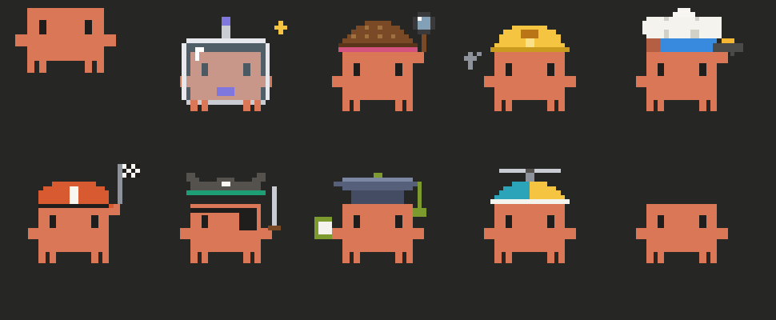

# Crab desk

A mod for Claude Code: a side pane that shows what Claude is doing while it works. It
draws in the desktop app and in the terminal. Open it with `/desk`.



## What it shows

- **The crab and his bubble:** what Claude is saying or doing now, and a quote when idle.
- **Plan:** the to-do list of the turn, as a bar and the step in hand.
- **Team:** each subagent with its model, effort, clock, steps, context and cost. A
  helper's costume tells its tier at a glance. The last group stays listed after a
  session is closed and opened again.
- **Files:** what the turn read and wrote, with each written file's diff.
- **Project:** a to-do list, or the milestones of a `progress.yaml` if the folder has
  one in the shape this was first built for.
- **Usage:** context, the 5-hour and weekly limits with their reset times, in green,
  yellow and red.
- **Heads up:** a side model reads each turn and leaves at most one note when
  something deserves your eye: a "done" the results do not support, a skipped check, a
  quiet trade-off, or a concept the task now depends on. Each note has Learn more,
  Knew this, Chat and Dismiss.
- **Hold:** a risky command (a recursive delete, for one) waits for Proceed or Cancel,
  with what it would remove.
- **Compact:** from 400k tokens of context, a band above the prompt asks Claude to
  save its state, compacts, and hands it its own note on what to continue.

## Before you install

- **A mod runs with your full permissions and is not sandboxed.** Read
  `hooks/register.js` before you trust it.
- **Heads up costs money.** It sends your recent requests and the last turn to a model
  (Opus at medium effort on Opus and Fable sessions) after turns that edit or run
  something. A reading is a few cents. Its count and cost show in the card's header.
- **The hold is a convenience, not a security boundary.** It catches the commands it
  knows; it is no substitute for permission rules.
- **Mods are new.** This was built against Claude Code 2.1.296, and the interface it
  uses may change in later versions.

## Install

```bash
git clone https://github.com/UTTAM-VAGHASIA/crab-desk ~/.claude/mods/crab-desk
claude plugin marketplace add ~/.claude/mods/crab-desk
claude plugin install crab-desk@uttam-mods --scope user
```

Restart Claude Code, then type `/desk`. In the terminal the pane docks beside the
transcript in fullscreen (`/tui fullscreen`) from 110 columns.

## Make Claude pick the right helper

The desk shows each helper's model; it does not choose it. Without a rule, a helper
inherits the session's model, and a trivial task runs on your most expensive one. Copy
the rules in [docs/helper-rules.md](docs/helper-rules.md) into your `CLAUDE.md` so
Claude picks Haiku for a lookup and saves Opus for work that needs it.

## Change it

The app runs a cached copy, so an edit shows only after a release:

1. Edit `hooks/register.js`.
2. Run the checks below.
3. Raise `version` in `.claude-plugin/plugin.json`.
4. `claude plugin marketplace update uttam-mods`, then
   `claude plugin update crab-desk@uttam-mods`.
5. Restart the session. `/reload-plugins` does not swap a running mod.

## Checks

```bash
node --check hooks/register.js
node dev/pure.test.mjs
npx -y -p typescript tsc -p . --noEmit --allowJs --checkJs --noImplicitAny false
claude plugin validate .
```

The type-check reports ten known errors that do no harm; an eleventh is a new one.
`node dev/preview.mjs` writes the desktop cards as HTML pages into `dev/`, to look at
in a browser in dark and light.

## Layout

- `hooks/register.js`: the whole mod.
- `.claude-plugin/`: the plugin's name and version, and the one-plugin marketplace
  (`uttam-mods`) it installs from.
- `dev/`: its tests and preview tools. They are not part of the mod.
- `CLAUDE.md`: what an agent working on this repo needs to know.

## Credits

The costumed helpers and the idea of tiers by model and effort are inspired by
savvy-progress. The Heads up card follows the idea of Claude Code's own "You should
know" plugin.

Not affiliated with Anthropic. The crab is Claude Code's own mascot, drawn here as a
tribute.

## License

MIT. See [LICENSE](LICENSE).
